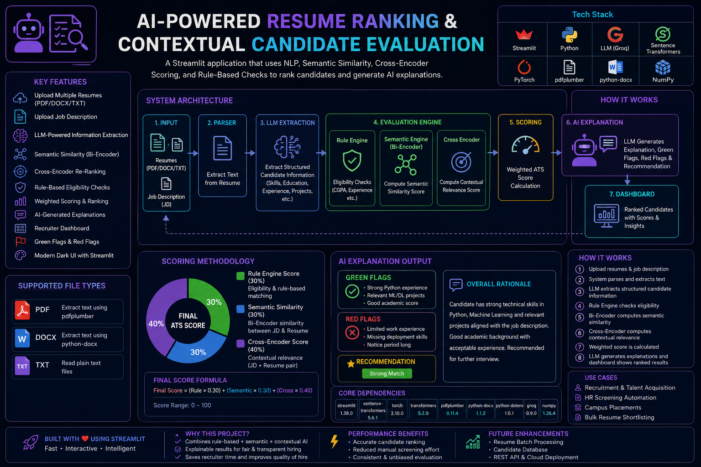
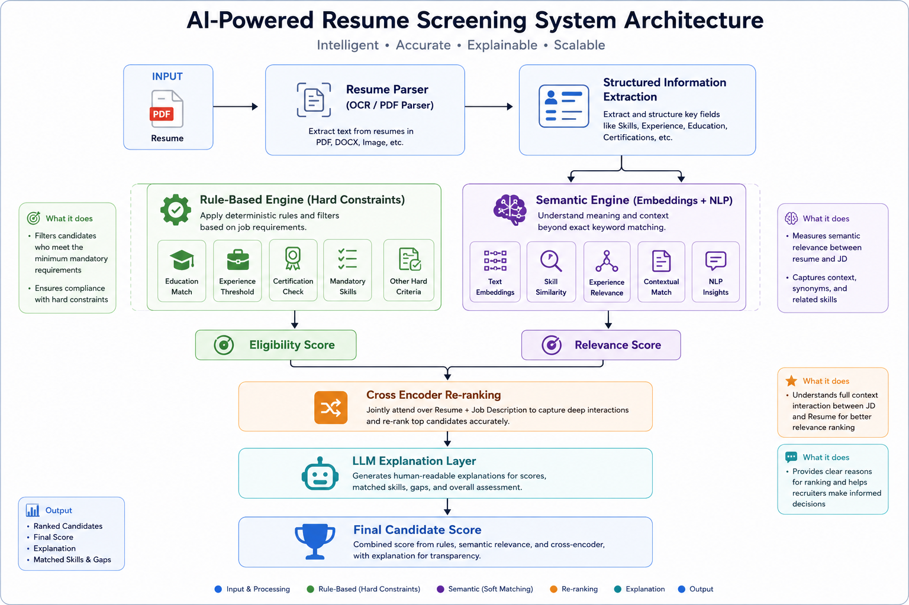
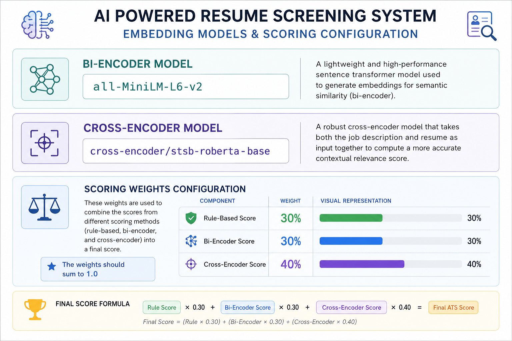
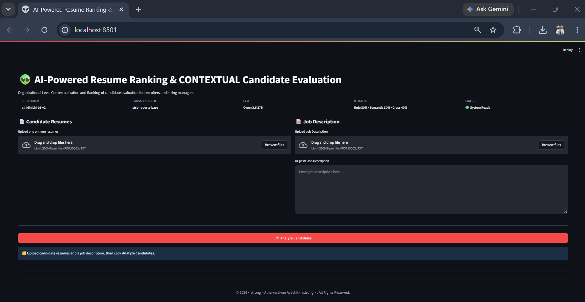
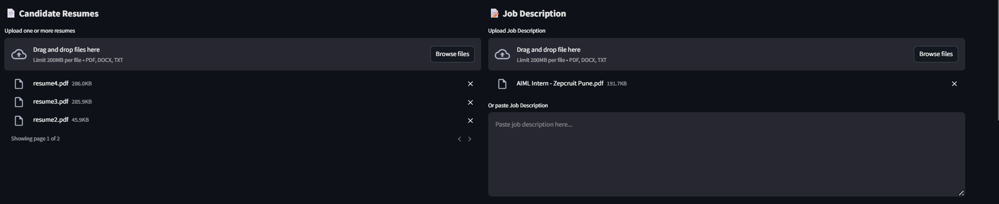
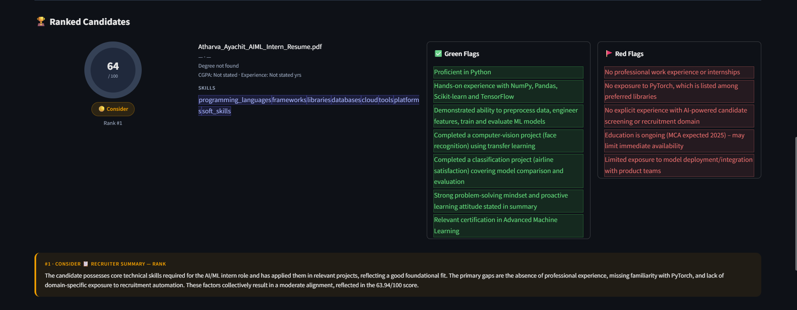

# 🤖 AI Powered Resume Ranking & Contextual Candidate Evaluation

<p align="center">


</p>

<p align="center">

</p>

---

# 📌 Overview

**AI Powered Resume Ranking & Contextual Candidate Evaluation** is an enterprise-inspired Applicant Tracking System (ATS) that intelligently evaluates resumes against job descriptions using a hybrid AI pipeline.

Unlike traditional ATS platforms that rely primarily on keyword matching, this project combines semantic understanding, contextual ranking, deterministic rule evaluation, and explainable AI to provide accurate and transparent hiring recommendations.

The system integrates modern NLP models, semantic embeddings, contextual ranking, and LLM-powered reasoning to help recruiters identify the most suitable candidates efficiently.

---
## 🌐 Live Demo

🚀 Try the application here:

**👉 http://ai-resume-ranking.streamlit.app**

# ✨ Key Features

- 📄 Upload multiple PDF and DOCX resumes
- 📝 Upload or paste a Job Description
- 🤖 LLM-based Resume Information Extraction
- 🧠 Structured Candidate Profile Generation
- 📊 Weighted ATS Score Calculation
- 🎯 Contextual Candidate Ranking
- 📈 Semantic Similarity Matching
- 📏 Rule-Based Eligibility Validation
- 💬 Explainable AI Recruiter Feedback
- 🟢 Green Flags & 🔴 Red Flags
- ✅ Matching Skills & ❌ Missing Skills
- 📋 Candidate Summary Dashboard
- 👨‍💻 Developer Pipeline Viewer
- ⚡ Interactive Streamlit Interface

---

# 🎯 Problem Statement

Recruiters often spend considerable time manually screening resumes before identifying qualified candidates. Conventional ATS systems frequently depend on exact keyword matching, causing potentially strong candidates to be overlooked if they use different terminology.

This project addresses these limitations by combining deterministic business rules with semantic search, contextual ranking, and Large Language Models to build a smarter and more explainable resume screening solution.

---

# 🚀 Solution

The application follows a multi-stage AI pipeline:

1. Parse resumes into clean text.
2. Extract structured candidate information using an LLM.
3. Evaluate mandatory hiring rules.
4. Compute semantic similarity between resumes and the job description.
5. Re-rank candidates using a Cross Encoder.
6. Calculate a weighted ATS score.
7. Generate recruiter-friendly explanations with strengths, weaknesses, and hiring recommendations.

This hybrid architecture balances traditional ATS logic with modern AI techniques, providing both accuracy and transparency throughout the hiring process.

---

# 🏗️ System Architecture

<p align="center">

</p>

---

# ⚙️ High-Level Architecture

```text
Resume(s)
    │
    ▼
Resume Parser
    │
    ▼
LLM Information Extraction
    │
    ├──────────────┐
    ▼              ▼
Rule Engine   Semantic Search
    │              │
    └──────┬───────┘
           ▼
    Cross Encoder
           │
           ▼
   Weighted ATS Score
           │
           ▼
LLM Recruiter Explanation
           │
           ▼
 Streamlit Dashboard


 # 🚀 Technology Stack

| Category | Technologies |
|----------|--------------|
| **Frontend** | Streamlit |
| **Backend** | Python 3.12 |
| **LLM** | Groq API (GPT-OSS / Qwen Configurable) |
| **Embedding Model** | all-MiniLM-L6-v2 |
| **Cross Encoder** | cross-encoder/stsb-roberta-base |
| **NLP** | Sentence Transformers, Semantic Search |
| **Document Parsing** | pdfplumber, python-docx |
| **Data Processing** | NumPy, Pandas |
| **Utilities** | JSON, Regular Expressions |

---

# 📂 Project Structure

```text
AI_Powered_Resume_Ranking_Contextual_Candidate_Evaluation/

├── app.py
├── config.py
├── requirements.txt
├── README.md
├── .env.example
├── .gitignore
│
├── assets/
│   ├── IMAGES/
│   └── screenshots/
│
├── modules/
│   ├── parser.py
│   ├── semantic_engine.py
│   ├── cross_encoder.py
│   ├── scorer.py
│   ├── rule_engine.py
│   └── llm/
│       ├── client.py
│       ├── extractor.py
│       ├── explainer.py
│       ├── prompts.py
│       └── schema.py
│
├── dev_tools.py
└── sample resumes and job descriptions/


# 🚀 Installation

## 1️⃣ Clone the Repository

```bash
git clone https://github.com/atharva-2011/AI_Powered_Resume_Ranking_Contextual_Candidate_Evaluation.git

cd AI_Powered_Resume_Ranking_Contextual_Candidate_Evaluation
```

---

## 2️⃣ Create a Virtual Environment

### Windows

```bash
python -m venv venv
venv\Scripts\activate
```

### Linux / macOS

```bash
python3 -m venv venv
source venv/bin/activate
```

---

## 3️⃣ Install Dependencies

```bash
pip install -r requirements.txt
```

<p align="center">

</p>

---

# 🔑 Environment Variables

Create a `.env` file in the project root.

```env
GROQ_API_KEY=YOUR_GROQ_API_KEY
GROQ_MODEL=openai/gpt-oss-120b
```

Configuration reference:

<p align="center">

</p>

---

# ▶️ Running the Application

Launch the Streamlit application:

```bash
streamlit run app.py
```

The application will automatically open in your default browser.

---

# 📄 Input Requirements

## Resume

Supported formats:

- PDF
- DOCX

The application supports uploading multiple resumes simultaneously, allowing recruiters to compare multiple candidates against a single Job Description.

---

## Job Description

Recruiters can either:

- Upload a Job Description document
- Paste the Job Description directly into the application

---

# 📋 Candidate Evaluation Workflow

```text
Upload Resume(s)
        │
        ▼
Upload / Paste Job Description
        │
        ▼
Resume Parsing
        │
        ▼
Candidate Information Extraction
        │
        ▼
Rule-Based Evaluation
        │
        ▼
Semantic Search
        │
        ▼
Cross Encoder Ranking
        │
        ▼
ATS Score Generation
        │
        ▼
AI Recruiter Explanation
        │
        ▼
Final Candidate Ranking
```

---

# 📸 Application Screenshots

## 🏠 Home Dashboard

<p align="center">

</p>

The Home Dashboard allows recruiters to upload resumes, provide a Job Description, configure evaluation settings, and initiate candidate ranking.

---

## 📑 Resume Parsing

<p align="center">

</p>

The Resume Parser extracts clean textual content from PDF and DOCX resumes before passing it to the LLM for structured information extraction.

---

## 👥 Multiple Resume Evaluation

<p align="center">

</p>

Multiple resumes can be evaluated simultaneously against a single Job Description, enabling recruiters to compare candidates side-by-side.

---

## 📊 Candidate Summary

<p align="center">

</p>

Each evaluated candidate receives:

- ATS Score
- Hiring Recommendation
- Matching Skills
- Missing Skills
- Green Flags
- Red Flags
- Experience Analysis
- Education Analysis
- Project Analysis
- Overall Recruiter Rationale

---

# 📁 Sample Dataset

The repository includes sample resumes and a sample Job Description for testing.

```text
sample resumes and job descriptions/

├── AIML Intern - Zepcruit Pune.pdf
├── resume1.pdf
├── resume2.pdf
├── resume3.pdf
├── resume4.pdf
├── resume5.pdf
├── resume6.pdf
├── resume7.pdf
├── resume8.pdf
├── resume9.pdf
└── resume10.pdf
```

These documents allow users to explore the complete evaluation pipeline without needing additional datasets.

---

# ✅ Features Tested

- ✔ PDF Resume Parsing
- ✔ DOCX Resume Parsing
- ✔ Multiple Resume Upload
- ✔ Job Description Upload
- ✔ Manual Job Description Input
- ✔ LLM Resume Extraction
- ✔ Rule-Based Candidate Evaluation
- ✔ Semantic Similarity Search
- ✔ Cross Encoder Ranking
- ✔ Weighted ATS Score Calculation
- ✔ Explainable AI Feedback
- ✔ Candidate Ranking Dashboard
- ✔ Recruiter Summary Generation

---

# 💻 Developer Notes

The project follows a modular architecture where every component has a dedicated responsibility.

Key design principles include:

- Modular Code Structure
- Separation of Concerns
- Reusable Components
- Easy Maintenance
- Scalable Architecture
- Independent AI Modules

The architecture makes it straightforward to extend the project with additional AI models, vector databases, cloud deployment, REST APIs, or recruiter management features without significant refactoring.

---

# 🌟 Future Enhancements

The project has been designed with scalability in mind and can be extended into a production-ready AI recruitment platform.

### Recruitment Features

- Candidate Database
- Recruiter Authentication
- Resume History
- Resume Batch Processing
- Recruiter Dashboard Analytics
- Candidate Comparison Dashboard
- Candidate Shortlisting
- Interview Scheduling
- Recruiter Feedback System

---

### AI Enhancements

- OCR Support for Scanned Resumes
- Resume Quality Scoring
- AI Resume Improvement Suggestions
- Skill Gap Analysis
- Candidate Fit Prediction
- Automatic Interview Question Generation
- Personalized Recruiter Insights
- Multilingual Resume Processing
- Resume Summarization

---

### Engineering Enhancements

- FastAPI REST API
- Docker Containerization
- PostgreSQL Integration
- Redis Caching
- CI/CD Pipeline
- Cloud Deployment (AWS, Azure, GCP)
- Authentication & Authorization
- Logging and Monitoring
- Unit & Integration Testing

---

# 💼 Use Cases

This project can be used by:

- HR Teams
- Recruiters
- Staffing Agencies
- Enterprise Hiring Teams
- Startups
- Placement Cells
- Universities
- Recruitment Consultants

It also serves as an educational project for learning:

- Large Language Models (LLMs)
- Resume Parsing
- Semantic Search
- Sentence Transformers
- Cross Encoder Ranking
- Prompt Engineering
- Explainable AI
- Streamlit Development
- Modular Python Architecture

---

# 🎯 Learning Outcomes

This project demonstrates practical implementation of:

- Resume Parsing
- Information Extraction using LLMs
- Prompt Engineering
- Semantic Search
- Sentence Embeddings
- Cross Encoder Re-ranking
- Rule-Based Decision Systems
- Explainable AI
- Modular Software Architecture
- Streamlit Application Development

---

# 📈 Project Highlights

- Hybrid AI-powered ATS architecture
- End-to-end automated resume screening
- Weighted ATS scoring mechanism
- Semantic resume-job matching
- Context-aware candidate ranking
- Explainable recruiter recommendations
- Clean modular codebase for easy scalability

---

# 🤝 Contributing

Contributions are welcome!

If you have ideas for improvements, bug fixes, or new features, feel free to fork the repository and submit a pull request.

### Steps to Contribute

1. Fork the repository

2. Create a feature branch

```bash
git checkout -b feature/your-feature
```

3. Commit your changes

```bash
git commit -m "Add your feature"
```

4. Push the branch

```bash
git push origin feature/your-feature
```

5. Open a Pull Request

---

# 📄 License

This project is licensed under the **MIT License**.

You are free to use, modify, and distribute this project in accordance with the terms of the license.

---

# 👨‍💻 Author

## Atharva Jivan Ayachit

**Aspiring AI/ML Engineer | Data Scientist | NLP Enthusiast**

- 📧 **Email:** atharvaayachit646@gmail.com
- 💻 **GitHub:** https://github.com/atharva-2011

---

# 🙏 Acknowledgements

This project was built using several outstanding open-source technologies and libraries:

- Python
- Streamlit
- Groq API
- Hugging Face Transformers
- Sentence Transformers
- pdfplumber
- python-docx
- NumPy
- Pandas
- Scikit-learn

Special thanks to the open-source community for developing and maintaining these incredible tools.

---

# ⭐ Support the Project

If you found this project helpful:

- ⭐ Star this repository
- 🍴 Fork the repository
- 🐞 Report issues
- 💡 Suggest improvements
- 🤝 Contribute to the project

Your support helps improve and expand this project for the community.

---

# 📬 Feedback

If you have any suggestions, feedback, or feature requests, feel free to open an issue or connect with me through GitHub.

Contributions and constructive feedback are always appreciated.

---

<p align="center">

## 🚀 Intelligent Resume Screening Powered by LLMs, Semantic Search, Cross-Encoder Ranking & Explainable AI

### Built with ❤️ using Python, Streamlit, NLP, and Modern AI

If you found this project useful, consider giving it a ⭐ on GitHub!

</p>